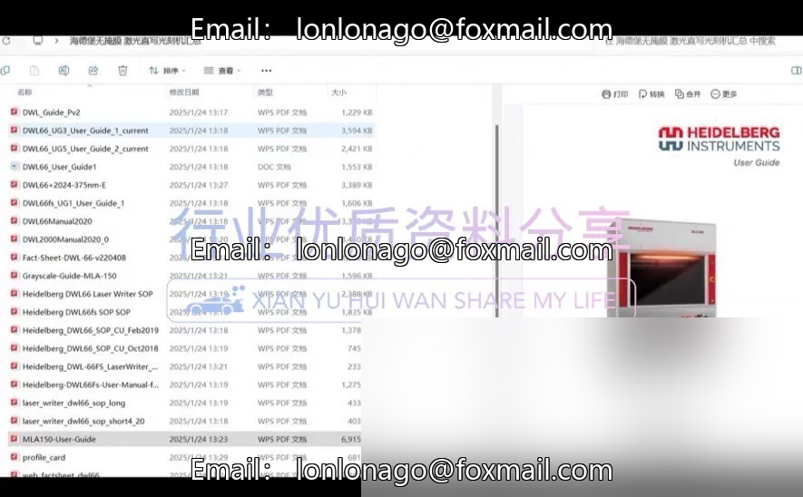
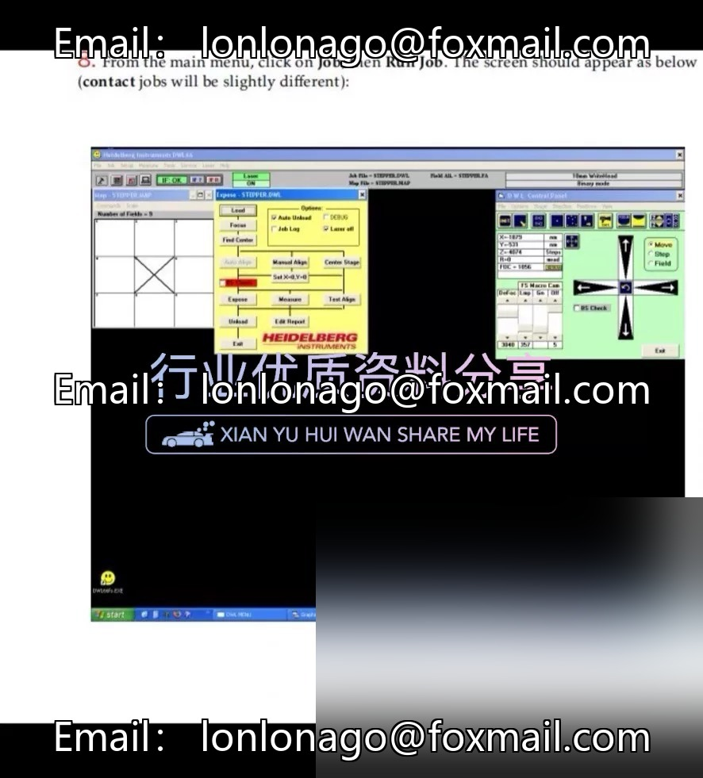
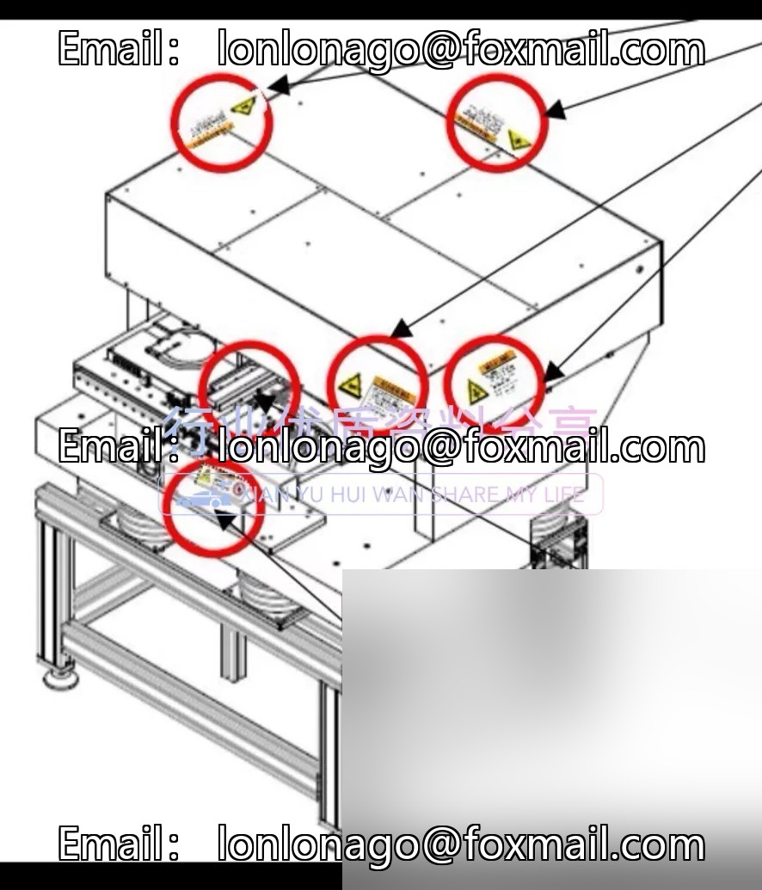
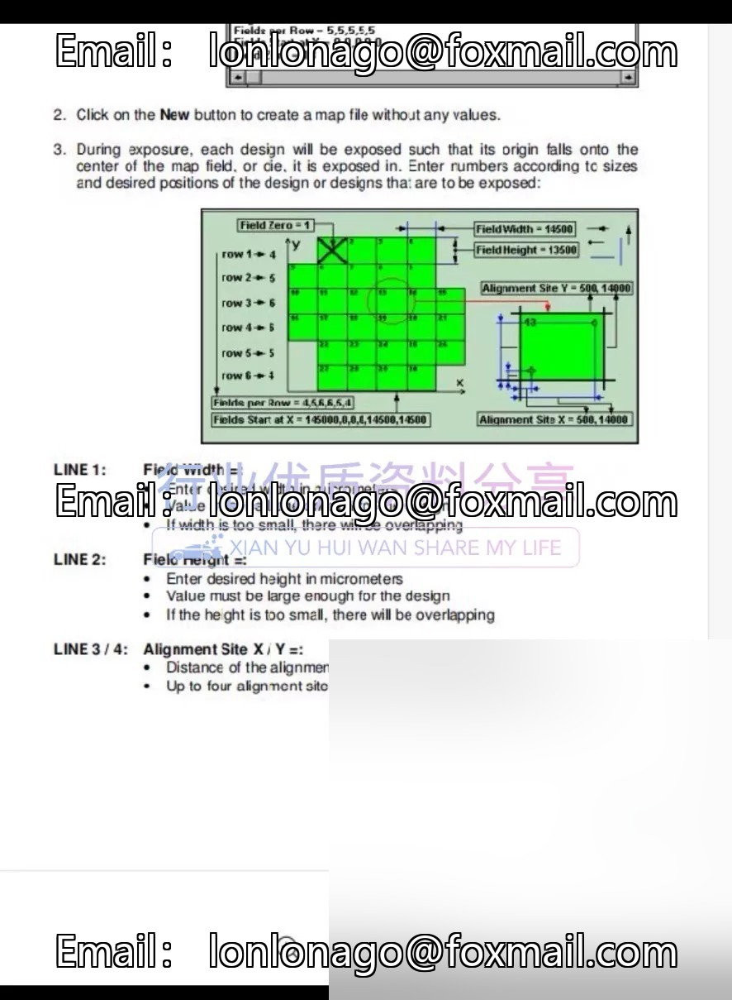
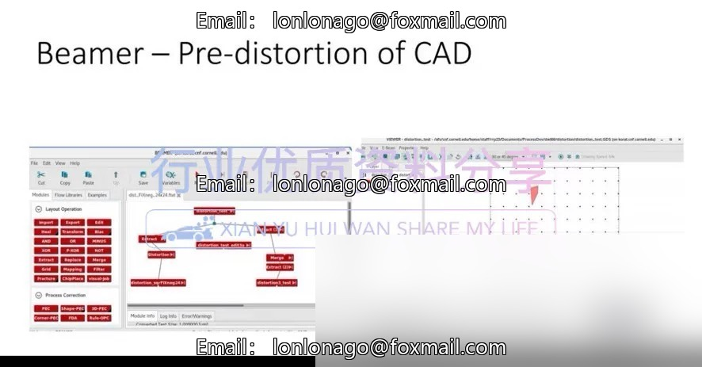
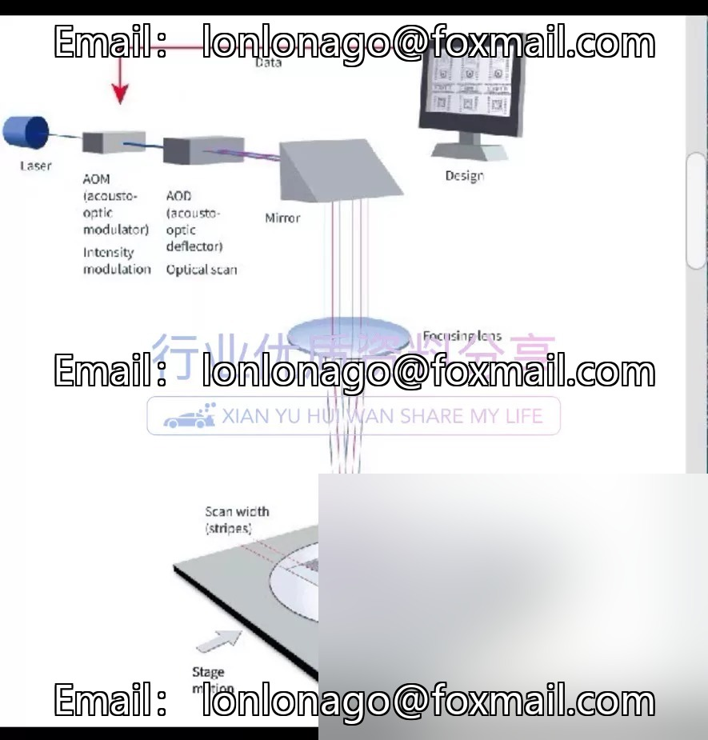
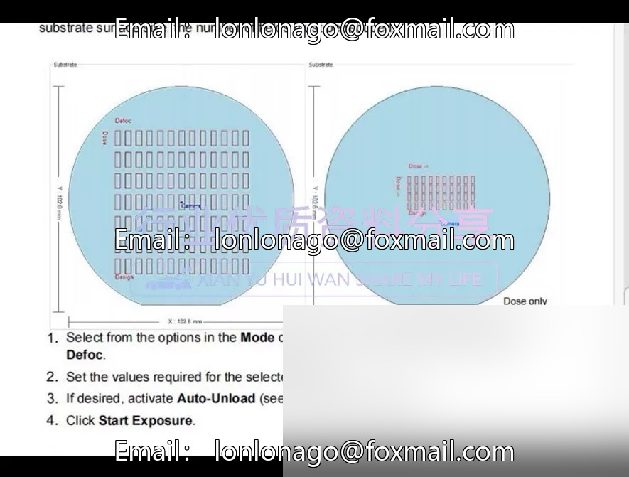

# Heidelberg laser direct writing lithography system materials complete set - German Heidelberg no mask laser direct writing lithography

## Body

Heidelberg Laser Direct-write Lithography System Materials Package - German Heidelberg No-mask Laser Direct-write Lithography Machine User Manual, SOP, software manual, etc., complete package of materials.

Capture and send the electronic original directly! The following images include screenshots of the file portion. Please confirm before placing the order! Due to the replicable nature of electronic documentation Therefore, are allowed after purchase! Thanks for understanding!

For personal learning and reference use only.

A complete set of Heidelberg laser direct writing photolithography system materials is provided, including user manuals, SOP, software manuals and file screenshots; the electronic original files must be obtained directly, and confirmation of the image file parts should be made before ordering.

<!-- AI_ENRICHED -->

## Images

## Payment

Here is a pay link on Stripe ( https://buy.stripe.com/3cs8yP7sY87d0vu9AB ). Please contact me lonlonago@foxmail.com after funding $89, and I will send you a complete data files , thank you!

